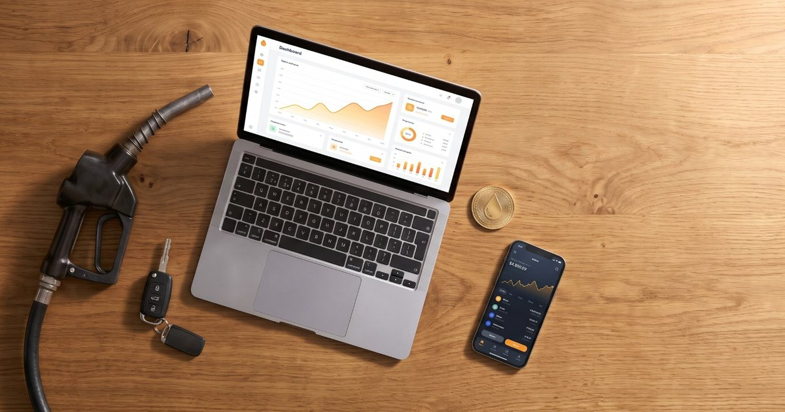

# FuelToken (demo 1)

Un concept a titolo didattico: un token su rete di prova che vale un litro di benzina, con il prezzo portato on-chain da un oracolo che legge i dati aperti del Ministero. Solo testnet Polygon Amoy, nessun valore reale, tutti i dati sono inventati.

- **Demo online:** https://rwa-fuel.blockchain.giuseppebosi.com
- **Tutorial (IT/EN):** https://rwa-fuel.blockchain.giuseppebosi.com/tutorial/
- **Versione inglese e istruzioni di avvio:** [README.md](README.md)
- **Autore:** Prof. Giuseppe Bosi, https://www.giuseppebosi.com , https://www.linkedin.com/in/giuseppebosi
- **Licenza:** MIT (vedi [LICENSE](LICENSE)).

- **Notebook (Google Colab, Python, senza chiavi):** `notebooks/` (i pulsanti "Apri in Colab" sono nelle pagine del tutorial).
